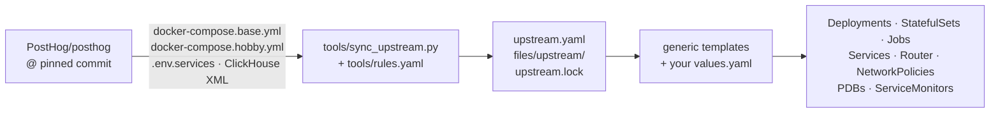
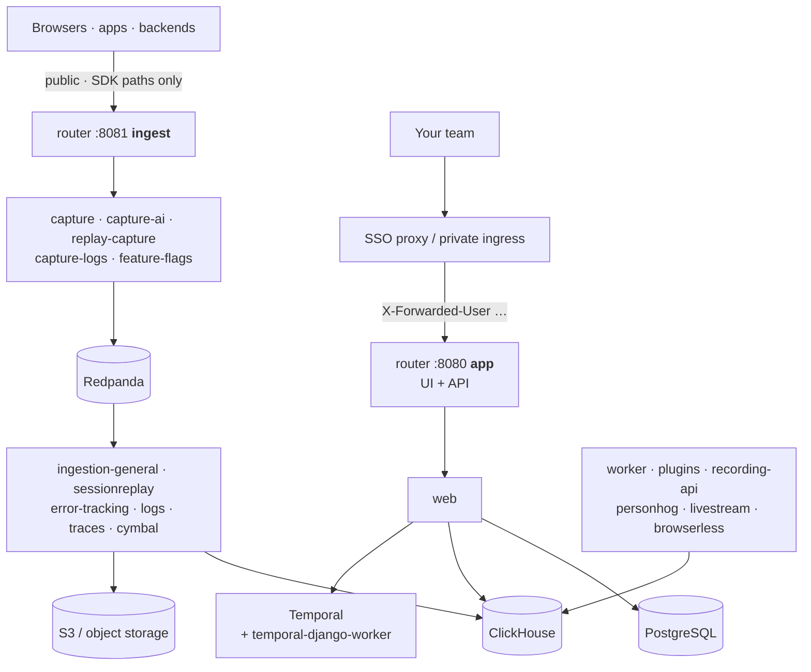

<h1 align="center">posthog-k8s</h1>

<p align="center">
  <b>Self-host <a href="https://posthog.com">PostHog</a> on Kubernetes with a Helm chart that is generated from PostHog's own compose file and proven end-to-end on every commit.</b><br>
  Product analytics · Web analytics · Session replay · Error tracking · Logs · Feature flags · Surveys
</p>

<p align="center">
  <a href="https://github.com/enricofranke/posthog-k8s/actions/workflows/ci.yml"></a>
  <a href="https://github.com/enricofranke/posthog-k8s/releases"></a>
  
  
  <a href="LICENSE"></a>
</p>

<p align="center">
  <a href="#step-by-step-guide"><b>Step-by-step guide</b></a> ·
  <a href="docs/production.md">Production setup</a> ·
  <a href="docs/argocd.md">Argo CD</a> ·
  <a href="docs/troubleshooting.md">Troubleshooting</a> ·
  <a href="CHANGELOG.md">Changelog</a> ·
  <a href="https://enricofranke.com/en/projects/posthog-kubernetes/">Project page</a>
</p>

```bash
helm install posthog oci://ghcr.io/enricofranke/charts/posthog \
  --namespace posthog --create-namespace \
  --set posthog.siteUrl=https://posthog.example.com
```

> [!NOTE]
> **Status: alpha (0.x).** Installs from scratch and passes an end-to-end test (signup, event,
> exception → issue, OTLP log, feature flag) on every commit. Runs in production for the
> maintainers with CloudNativePG and S3. Values may still change before 1.0; in-place chart
> upgrades are not yet covered by CI.
>
> Not affiliated with or endorsed by PostHog Inc. PostHog [stopped supporting Kubernetes in 2023](https://posthog.com/blog/sunsetting-helm-support-posthog)
> and archived its chart in 2026. This project exists for the people who still want PostHog next to
> their other workloads, with GitOps, their own Postgres and their own S3.

---

## Contents

- [Why this chart](#why-this-chart)
- [How it works](#how-it-works)
- [Step-by-step guide](#step-by-step-guide)
  - [0. What you need](#0-what-you-need)
  - [1. Try it locally (kind or k3s)](#1-try-it-locally-kind-or-k3s)
  - [2. Production install](#2-production-install)
  - [3. First login and a test event](#3-first-login-and-a-test-event)
  - [4. Upgrading](#4-upgrading)
  - [5. Uninstalling](#5-uninstalling)
  - [6. Troubleshooting](#6-troubleshooting)
- [Reference](#reference): identity-aware proxy, schema seed, sizing, operations, scope, repository layout
- [Contributing, support, license](#contributing-support-license)

## Why this chart

PostHog's only supported self-hosting path is a ~35-container docker-compose file on a single
VM. That file is excellent and kept current by PostHog. Hand-written Kubernetes manifests drift
from it within weeks. So this chart does not hand-write anything: a generator reads the compose
files at a pinned upstream commit and turns them into chart data; generic templates render the
Kubernetes objects. Upgrading PostHog is "bump the commit, read the diff, run CI".

| | |
|---|---|
| 🚪 **Two front doors** | A Caddy router with an `app` listener (full UI and API, put it behind your SSO proxy) and an `ingest` listener that forwards **only** SDK paths and strips identity headers. Your login page never has to be on the internet. |
| 🗄️ **Your datastores** | External PostgreSQL (a CloudNativePG `uri` secret works out of the box) and S3-compatible object storage for replays and exports. Bundled single-node PostgreSQL and SeaweedFS for evaluation. |
| 🔑 **Secrets by reference** | Every secret can live in a Secret you own. When you let the chart generate them, they are created once and kept. Nothing secret in the pod spec. |
| 📌 **Pinned and signed** | Every image pinned by digest (upstream images at sync time, the chart's own Caddy, PostgreSQL and SeaweedFS in `values.yaml`); chart releases pushed to GHCR and signed with cosign (keyless). `appVersion` is the upstream commit. |
| 🛡️ **Secure defaults** | Non-root everywhere, all capabilities dropped, no service-account tokens, optional NetworkPolicies, PodDisruptionBudgets, ClickHouse application users with real passwords. |
| ⚡ **Fast first start** | A schema seed skips the 20-minute migration marathon of a fresh database. |
| ✅ **Tested for real** | Generator unit tests, `helm lint`, `helm unittest`, `kubeconform`, Caddy config validation, and a full install on kind that signs up, sends an event, an exception, an OTLP log line and evaluates a flag. |

## How it works



Everything the generator does not understand is a hard error, not a guess: a new service, a new
variable or a new hostname in the compose file fails the sync until `tools/rules.yaml` says what
to do with it. `upstream.lock` records the commit and the sha256 of every input.

Inside the cluster (simplified):



<details>
<summary>Full service list</summary>

```
web · worker · temporal-django-worker · plugins · ingestion-{general,sessionreplay,error-tracking,logs,traces}
recording-api · capture · capture-ai · replay-capture · capture-logs · feature-flags · property-defs(-rs,-ai) · hypercache-server
livestream · personhog-{router,replica} · cymbal · cymbal-resolution · browserless
ClickHouse · Zookeeper · Redpanda · Redis · Valkey · Temporal · PostgreSQL* · SeaweedFS*      (* or external)
```

</details>

---

## Step-by-step guide

The same guide, condensed, is on the project page:
[enricofranke.com/en/projects/posthog-kubernetes/guide/](https://enricofranke.com/en/projects/posthog-kubernetes/guide/)
(German: [Anleitung](https://enricofranke.com/projekte/posthog-kubernetes/anleitung/)).

### 0. What you need

| | Evaluation | Production |
|---|---|---|
| **Kubernetes** | 1.30 or newer (kind, k3s, k0s, Docker Desktop) | 1.30 or newer |
| **Memory** | ~16 GB allocatable with the CI values, ~18 GB with the defaults | ~18 GB requested by default, more for busy instances (see Sizing under [Reference](#reference)) |
| **Storage** | a default StorageClass | fast disks for ClickHouse and Redpanda (~160 GB by default) |
| **PostgreSQL** | bundled (15.12) | external, **15 or newer** (CloudNativePG, RDS, …) |
| **Object storage** | bundled SeaweedFS | an S3-compatible bucket |
| **Tools** | `kubectl`, Helm 3.8+ (OCI) | the same, plus your GitOps tool of choice |

### 1. Try it locally (kind or k3s)

**1.1 Create a cluster.** Give Docker (Desktop) at least 16 GB of memory first.

```bash
# kind
kind create cluster --name posthog

# or k3s on a Linux box (ships the local-path StorageClass)
curl -sfL https://get.k3s.io | sh -
export KUBECONFIG=/etc/rancher/k3s/k3s.yaml
```

**1.2 Install the chart.** On a 16 GB machine start from the values CI uses. They contain fixed,
public test secrets, so use them on your laptop only:

```bash
helm install posthog oci://ghcr.io/enricofranke/charts/posthog \
  --namespace posthog --create-namespace \
  -f https://raw.githubusercontent.com/enricofranke/posthog-k8s/main/charts/posthog/ci/kind-values.yaml
```

With more memory, take the defaults and let the chart generate the secrets:

```bash
helm install posthog oci://ghcr.io/enricofranke/charts/posthog \
  --namespace posthog --create-namespace \
  --set posthog.siteUrl=http://localhost:8080 \
  --set posthog.publicUrl=http://localhost:8081 \
  --set posthog.secureCookies=false
```

**1.3 Wait for the first start.** A fresh database runs ~1,500 PostgreSQL and ~300 ClickHouse
migrations: 15–25 minutes on a laptop. `web` and the workers sit in `Init:0/1` until the
`migrate` Job is through. That is expected.

```bash
kubectl -n posthog get pods -w
kubectl -n posthog logs -f $(kubectl -n posthog get jobs -l app.kubernetes.io/component=migrate --sort-by=.metadata.creationTimestamp -o name | tail -1)
```

**1.4 Open it.** Forward both router listeners and continue with [step 3](#3-first-login-and-a-test-event):

```bash
kubectl -n posthog port-forward svc/posthog-router 8080:8080 8081:8081
# UI: http://localhost:8080   ingest: http://localhost:8081
```

### 2. Production install

The setup the maintainers run: CloudNativePG, S3, the UI behind an identity-aware proxy, SDK
traffic on a public hostname, secrets from a secret manager, deployed by Argo CD. Every step in
full detail: [docs/production.md](docs/production.md).

**2.1 Namespace.** ClickHouse, Redpanda and Temporal are not `restricted`-clean; use `baseline`:

```bash
kubectl create namespace posthog
kubectl label namespace posthog \
  pod-security.kubernetes.io/enforce=baseline \
  pod-security.kubernetes.io/warn=restricted
```

**2.2 PostgreSQL 15+.** With CloudNativePG, create the cluster plus the two Temporal databases
(`temporal`, `temporal_visibility`) as `Database` resources. The manifests are in
[docs/production.md § 2](docs/production.md#2-postgresql-cloudnativepg). CNPG then generates the
Secret `posthog-pg-app`, which the chart reads directly.

**2.3 Object storage.** One bucket and one IAM user restricted to it. Session replays, exports,
symbol sets and AI blobs go there; budget roughly 1 GB per 200 recordings. Minimal IAM policy:
[docs/production.md § 3](docs/production.md#3-object-storage-s3).

**2.4 Secrets.** Sync them from your secret manager (External Secrets, Sealed Secrets, SOPS). For
a first try, plain `kubectl` does the same:

```bash
kubectl -n posthog create secret generic posthog-app \
  --from-literal=SECRET_KEY="$(openssl rand -hex 32)" \
  --from-literal=ENCRYPTION_SALT_KEYS="$(openssl rand -hex 16)" \
  --from-literal=BROWSERLESS_TOKEN="$(openssl rand -hex 32)" \
  --from-literal=INTERNAL_API_SECRET="$(openssl rand -hex 32)" \
  --from-literal=INTERNAL_REQUEST_TOKEN="$(openssl rand -hex 32)" \
  --from-literal=RECORDING_API_JWT_SECRET="$(openssl rand -hex 32)"

kubectl -n posthog create secret generic posthog-clickhouse \
  --from-literal=CLICKHOUSE_API_PASSWORD="$(openssl rand -hex 24)" \
  --from-literal=CLICKHOUSE_APP_PASSWORD="$(openssl rand -hex 24)" \
  --from-literal=CLICKHOUSE_BILLING_PASSWORD="$(openssl rand -hex 24)" \
  --from-literal=CLICKHOUSE_DICT_READER_PASSWORD="$(openssl rand -hex 24)" \
  --from-literal=CLICKHOUSE_SIGNALS_PASSWORD="$(openssl rand -hex 24)"

kubectl -n posthog create secret generic posthog-s3 \
  --from-literal=accessKeyId=AKIA... --from-literal=secretAccessKey=...
```

> [!IMPORTANT]
> `ENCRYPTION_SALT_KEYS` (32 hex characters) must never change once data exists. Back it up with
> your PostgreSQL backups.

**2.5 Values.** A complete `values.yaml` for this setup:

```yaml
posthog:
  siteUrl: https://posthog.example.com     # the UI, behind your SSO proxy or private ingress
  publicUrl: https://ph.example.com        # what browsers and mobile apps send events to
  existingSecret: posthog-app
  multiOrg: true                           # one organization per product or team

secrets:
  keys:                                    # route any key to a Secret you manage
    CLICKHOUSE_API_PASSWORD: {secret: posthog-clickhouse}
    CLICKHOUSE_APP_PASSWORD: {secret: posthog-clickhouse}
    CLICKHOUSE_BILLING_PASSWORD: {secret: posthog-clickhouse}
    CLICKHOUSE_DICT_READER_PASSWORD: {secret: posthog-clickhouse}
    CLICKHOUSE_SIGNALS_PASSWORD: {secret: posthog-clickhouse}

postgresql:
  bundled: false
  external:
    host: posthog-pg-rw                    # CloudNativePG service
    username: app
    database: posthog
    existingSecret: posthog-pg-app         # the CNPG app secret
    urlKey: uri                            #   -> DATABASE_URL
    passwordKey: password                  #   -> PGPASSWORD
temporal:
  skipDbCreate: true                       # temporal + temporal_visibility exist (step 2.2)

objectStorage:
  endpoint: https://s3.eu-central-1.amazonaws.com
  bucket: my-posthog
  region: eu-central-1
  forcePathStyle: false                    # true for MinIO, SeaweedFS, Ceph
  existingSecret: posthog-s3               # keys accessKeyId / secretAccessKey
  bundled: {enabled: false}

services:
  clickhouse:
    persistence: {size: 200Gi, storageClass: fast-ssd}
  kafka:
    persistence: {size: 50Gi, storageClass: fast-ssd}

router:
  ingress:
    enabled: true
    className: nginx
    hosts:
      - {host: ph.example.com, listener: ingest}   # public: SDK paths only
      # the app listener is reached through Teleport / oauth2-proxy / a private ingress instead

networkPolicy:
  enabled: true
  ingestIngressFrom:
    - namespaceSelector: {matchLabels: {kubernetes.io/metadata.name: ingress-nginx}}
  appIngressFrom:
    - namespaceSelector: {matchLabels: {kubernetes.io/metadata.name: teleport}}
```

**2.6 Traffic.** Two hostnames, two listeners:

- `posthog.example.com` → `posthog-router:8080` (UI and API). Only reachable through your
  identity-aware proxy (Teleport, oauth2-proxy, Pomerium, Authelia, Cloudflare Access) or a private
  ingress.
- `ph.example.com` → `posthog-router:8081` (SDK ingest). Public. Anything that is not an SDK path
  gets a 404.

Using a tunnel instead of an Ingress (Cloudflare Tunnel, for example)? Point it at
`http://posthog-router.posthog.svc:8081` and keep `router.ingress.enabled: false`. Backends in
the same cluster send to `http://posthog-router.posthog.svc:8081` directly.

**2.7 Install.**

```bash
helm install posthog oci://ghcr.io/enricofranke/charts/posthog \
  --namespace posthog --version 0.2.0 -f values.yaml
```

With **Argo CD**, use the Application from [docs/argocd.md](docs/argocd.md), with
`ServerSideApply=true` and every secret external (Argo renders without `lookup`, so generated
secrets would change on every sync).

**2.8 Before going live**, work through the checklist in
[docs/production.md § 8](docs/production.md#8-checklist-before-going-live): PITR and a restore
drill, a ClickHouse backup job, bucket versioning, alerts, 2FA for admins.

### 3. First login and a test event

1. Open the UI (`posthog.siteUrl`) and create the first user. It becomes the owner of the first
   organization; signup closes automatically afterwards. Invite everyone else from the UI.
2. Copy the project API key: **Settings → Project → Project API key** (`phc_…`).
3. Send an event to the ingest listener:

   ```bash
   TOKEN=phc_...
   curl -X POST http://localhost:8081/e/ -H 'Content-Type: application/json' \
     -d "{\"api_key\":\"$TOKEN\",\"event\":\"hello\",\"distinct_id\":\"me\"}"
   ```

   In production, replace `http://localhost:8081` with your `publicUrl`. The event shows up under
   **Activity** within seconds.
4. Add the JavaScript snippet from **Settings → Project** to your site, with `api_host` set to
   your `publicUrl`.

### 4. Upgrading

1. Read the [CHANGELOG](CHANGELOG.md) entry of every version you skip, in particular its
   **Upgrade notes**.
2. Back up first: PostgreSQL (PITR or a dump) and ClickHouse
   (`BACKUP DATABASE posthog TO File('/var/lib/clickhouse/backups/<name>')`, the chart allows that
   path). `helm rollback` rolls the pods back, not the schema.
3. Upgrade and watch the `migrate` Job:

   ```bash
   helm upgrade posthog oci://ghcr.io/enricofranke/charts/posthog \
     --namespace posthog --version <new version> -f values.yaml
   kubectl -n posthog get pods -w
   ```

   With Argo CD, bump `targetRevision`.

> [!WARNING]
> **0.1.x → 0.2.0** moves PostHog from `18b824b7` (2026-09-11) to `4ba4b09d` (2026-11-03). Before
> upgrading, check the [0.2.0 upgrade notes](CHANGELOG.md#020---2026-11-03):
> - PostgreSQL **15 or newer** is required (`SELECT version()` on an external server).
> - ClickHouse moves from 26.6 to 26.9 (PostHog's build). There is no way back once 26.9 has
>   written data, so **back it up first**.
> - New secrets: `INTERNAL_REQUEST_TOKEN` and `RECORDING_API_JWT_SECRET` in the app Secret,
>   `CLICKHOUSE_SIGNALS_PASSWORD` in the ClickHouse Secret (map it in `secrets.keys`).
> - Installs from before 2026-10-28 have an empty `raw_sessions_v3` in the old shape. The migrate
>   Job rebuilds it on its own (`migrations.sessionsV3Reset`, log line `sessions-v3 reset:`). If that
>   table holds rows, the Job stops and prints the manual steps; check beforehand with
>   `SELECT count() FROM sharded_raw_sessions_v3`.
> - Check the `$ai_*` topic change on capture, and terminate Temporal workflows that were started on
>   the per-product queues before the upgrade.
> - Replay Vision and video exports need the new recording rasterizer, and it needs a seccomp
>   profile on the nodes ([docs/rasterizer.md](docs/rasterizer.md)); without it the pod restarts
>   with `No usable sandbox!`. Gemini is reached only through an AI gateway now:
>   `REPLAY_VISION_GEMINI_API_KEY` is gone, enable `geminiGateway` ([docs/gemini-gateway.md](docs/gemini-gateway.md)).
> - Argo CD: once the new `migrate` Job is through, delete the old `<release>-migrate-*` Job. It
>   predates 0.2.0's `IgnoreExtraneous` and otherwise keeps the Application OutOfSync. A sync stuck
>   retrying it (`spec.selector: Required value`) needs its operation terminated first.

### 5. Uninstalling

```bash
helm uninstall posthog --namespace posthog
kubectl -n posthog get pvc                 # volumes of ClickHouse, Redpanda, Zookeeper, Redis stay
kubectl -n posthog delete pvc --all        # only if you really want the data gone
kubectl delete namespace posthog
```

External PostgreSQL databases and the S3 bucket are not touched; delete them yourself if needed.
PersistentVolumes with the `Retain` policy keep their data on the node until you remove them.

### 6. Troubleshooting

| Symptom | Usual cause |
|---|---|
| `web` and the workers stay in `Init:0/1` | The `migrate` Job is still running (15–25 min on a fresh database) or waits for ClickHouse/PostgreSQL. Follow its logs. |
| `wait-for-migrations` init container `OOMKilled` | Upstream's Django 6.1 needs more than 1 Gi for `migrate --check`; 0.2.0 sets 2 Gi (`migrations.waitResources`). |
| Replay Vision, alerts, subscriptions, session summaries or video exports never run | Fixed in 0.2.0 (one Temporal worker polls every queue, search attributes registered, PostHog's Temporal schedules created, recording rasterizer added). Workflows started before the upgrade stay on their old queue: terminate them. The rasterizer needs a seccomp profile: [docs/rasterizer.md](docs/rasterizer.md). |
| Scans fail with `GatewayNotConfiguredError` | Replay Vision reaches Gemini only through an AI gateway: enable `geminiGateway` ([docs/gemini-gateway.md](docs/gemini-gateway.md)). |
| Exceptions arrive, but no issue appears | `cymbal` cannot reach the bucket; check `cymbal-resolution` logs for `NoSuchBucket`. |
| The ingest listener answers 404 | By design for anything that is not an SDK path; see `router.ingest.webPaths`. |

More symptoms and the commands to look at them: [docs/troubleshooting.md](docs/troubleshooting.md).
`e2e/diagnose.sh <namespace>` prints exit reasons, previous logs and events in one go.

---

## Reference

<details>
<summary><b>Behind an identity-aware proxy</b></summary>

Point your proxy (Teleport Application Access, oauth2-proxy, Pomerium, Authelia, Cloudflare
Access) at `<release>-router:8080` and expose `<release>-router:8081` publicly for SDK traffic.
The ingest listener answers 404 for anything that is not an SDK path and strips identity headers
(`router.stripHeaders`). Header-based automatic login and group → organization mapping is the next
milestone; see [docs/auth-proxy.md](docs/auth-proxy.md). A complete Teleport example lives in
[docs/production.md](docs/production.md#teleport-example).

</details>

<details>
<summary><b>Fast first start (schema seed)</b></summary>

A fresh PostHog database needs ~1,500 PostgreSQL and ~300 ClickHouse migrations. On a small
cluster that is 10–25 minutes during which `web` is not ready. A **schema seed** (a `pg_dump` plus
a native ClickHouse `BACKUP` of an already-migrated, empty instance) is restored by the bundled
datastores on their first start, so the `migrate` job only has to confirm.

```yaml
seed:
  hostPath: /var/lib/posthog-seed      # posthog.pgdump + clickhouse/seed/ on the node
  # or: existingClaim: posthog-seed    # a PVC with the same layout
```

Releases ship `posthog-schema-seed-<version>.tar.gz` when CI produced one for that upstream
commit; `e2e/export-seed.sh` produces one from a running release. CI uses the same mechanism: a
cold end-to-end run installs in ~27 minutes on a 4 vCPU runner, a seeded one in ~10.

</details>

<details>
<summary><b>Sizing</b></summary>

Defaults request about 18 GB of memory across ~34 pods and 160 GB of volumes (ClickHouse 100,
Redpanda 50, PostgreSQL 20, SeaweedFS 50 when bundled). Measured on a 3-project instance with
2 M events and 6,500 recordings per month: ~20 GB RSS in total, ClickHouse and web being the
largest. Concurrency knobs: `GRANIAN_WORKERS` (web, default 2) and `WEB_CONCURRENCY` (celery,
default 2) via `services.<name>.env`.

</details>

<details>
<summary><b>Operations</b></summary>

| | |
|---|---|
| **Upgrade PostHog** | `make sync UPSTREAM=<commit>` regenerates `upstream.yaml`; read the diff; CI installs it. Data migrations run in the `migrate` Job on every install and upgrade. Back up first; `helm rollback` rolls pods back, not the schema. |
| **Backups** | PostgreSQL holds everything you cannot lose (users, dashboards, flags, issues) plus `ENCRYPTION_SALT_KEYS` from the env secret. ClickHouse: `BACKUP DATABASE posthog TO File('/var/lib/clickhouse/backups/<name>')` (the chart allows that path). Object storage: bucket versioning. |
| **Monitoring** | `metrics.serviceMonitor.enabled` renders ServiceMonitors for services that expose Prometheus metrics. |
| **Troubleshooting** | [docs/troubleshooting.md](docs/troubleshooting.md): why a pod waits, where the migrate job logs, what the compat aliases are for. |
| **Replay Vision** | [docs/rasterizer.md](docs/rasterizer.md): the recording rasterizer, its seccomp profile and egress. [docs/gemini-gateway.md](docs/gemini-gateway.md): the Gemini key, through the chart's stand-in for PostHog's AI gateway. |

</details>

<details>
<summary><b>What is and is not included</b></summary>

**Included:** every service from `docker-compose.hobby.yml` except the ones replaced by
cluster-native pieces: `db` → bundled PostgreSQL template or external; `seaweedfs`/`objectstorage`
→ S3 or bundled SeaweedFS; `proxy` → the router; `elasticsearch` → Temporal on PostgreSQL
visibility; `temporal-ui`/`temporal-admin-tools` → not workloads.

**Not (yet):** high availability for ClickHouse and Redpanda (single instance on a
PersistentVolume, same as the compose deployment; PostHog's replicated ClickHouse layout is a
separate project); external ClickHouse/Kafka; PostHog's paid features (Cloud-only; the `ee/`
code has its own license and this chart does not enable it); automatic upstream bumps without a
human reading the diff.

</details>

<details>
<summary><b>Repository layout</b></summary>

```
charts/posthog/           the chart (templates are generic, data is generated)
  upstream.yaml           GENERATED service definitions
  upstream.lock           GENERATED upstream commit + input hashes
  files/upstream/         GENERATED config files (ClickHouse XML, Kafka topics, Temporal config)
  files/chart/            chart-owned files (web start script, zoo.cfg, seed hooks)
  ci/kind-values.yaml     values for the CI end-to-end run
  tests/                  helm-unittest suites
tools/                    generator + rules + tests
e2e/                      install/smoke/seed scripts used by CI
docs/                     production, Argo CD, troubleshooting, auth proxy roadmap
```

</details>

## Contributing, support, license

Issues and PRs welcome, in particular: verified production setups, external ClickHouse/Kafka,
the auth-proxy overlay, HA ClickHouse. See [CONTRIBUTING.md](CONTRIBUTING.md). There is no
commercial support and no SLA; the maintainers run this chart themselves and fix what breaks for
them first. Security reports: [SECURITY.md](SECURITY.md).

Apache-2.0 for everything in this repository. PostHog is MIT-licensed except the `ee/`
directory, which has its own license; the chart uses PostHog's public images unmodified and
does not enable enterprise features. "PostHog" is a trademark of PostHog Inc.
