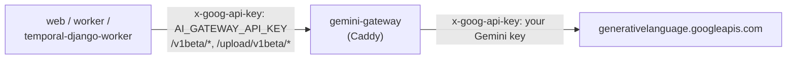

# Gemini gateway (Replay Vision)

Replay Vision analyses recordings with Google Gemini. Upstream builds that client only through
PostHog's AI gateway (`posthog/llm/gateway_client.py`, `build_gemini_client`), so there is no
direct route to Google any more: `REPLAY_VISION_GEMINI_API_KEY` and `GEMINI_API_KEY` no longer
reach it. Without a gateway, every scan fails after rendering with

```text
GatewayNotConfiguredError: AI_GATEWAY_URL and AI_GATEWAY_API_KEY must be configured
```

PostHog's gateway is a Go service that it does not publish (no public source, private image). The
chart ships a small stand-in instead, `<release>-gemini-gateway`. It is a Caddy proxy (the router's
image) that serves only the Gemini API:



- It accepts `/v1beta/*` and `/upload/v1beta/*` only with the internal token `AI_GATEWAY_API_KEY`.
  Other requests get 401.
- It replaces that token with your Gemini key and forwards the request to `geminiGateway.upstream`.
- It drops PostHog's `X-PostHog-*` label headers (team, distinct id, trace) and `X-Forwarded-*`
  before the request reaches Google.
- It rewrites `X-Goog-Upload-URL` in the response to its own address, because PostHog's client
  sends the upload chunks there and refuses any origin but the gateway's.
- It streams responses (`flush_interval -1`); long scans run past the 290 s cut of buffered calls.
- It answers PostHog's OpenAI and Anthropic gateway routes (`/v1/chat/completions`,
  `/v1/messages`) with 501.
- It has no access log, and its error log drops the token header.

## Setup

1. Get a Gemini API key (Google AI Studio) and put it in a Secret.
2. Enable the gateway and map the key:

   ```yaml
   geminiGateway:
     enabled: true
   secrets:
     keys:
       GEMINI_API_KEY: {secret: posthog-gemini, key: api-key}
       # GitOps: keep the internal token in a Secret too, otherwise it is generated on every render.
       AI_GATEWAY_API_KEY: {secret: posthog-gemini, key: gateway-token}
   ```

   ```bash
   kubectl -n posthog create secret generic posthog-gemini \
     --from-literal=api-key="$GEMINI_API_KEY" \
     --from-literal=gateway-token="$(openssl rand -hex 32)"
   ```

   With `posthog.existingSecret`, `AI_GATEWAY_API_KEY` is read from that Secret unless mapped.
   `helm install` without a Secret: `geminiGateway.geminiApiKey` inline, and the token is generated
   once and kept through `lookup`.
3. web, worker and temporal-django-worker get `AI_GATEWAY_URL=http://<release>-posthog-gemini-gateway:8080/v1`
   and `AI_GATEWAY_API_KEY` (`geminiGateway.clients`). Scans run in temporal-django-worker; scanner
   drafts, suggested questions and themes run in web.

The gateway refuses to start when either key is empty. With `networkPolicy.enabled` it may reach
DNS and public addresses on 443 only. Ingress comes through the release's internal policy, and the
rasterizer's egress policy keeps the browser away from it.

## Side effects

`AI_GATEWAY_URL` is PostHog's switch for every feature that uses its gateway. Once it is set, those
features call this one instead of failing with "LLM_GATEWAY_URL ... must be configured", and they get
the 501 above if they ask for OpenAI or Anthropic models. This affects task titles, signals, LLM
analytics evaluations and semantic enrichment. On a self-hosted instance without PostHog's gateways
they did not work before either; the error message just changes.

Generations do not show up in LLM analytics, because PostHog's gateway is what captures them. Replay
Vision still counts credits per observation in Django (`REPLAY_VISION_MONTHLY_CREDIT_QUOTA`).

## Checking it

```bash
kubectl -n posthog logs deploy/posthog-gemini-gateway          # errors only
kubectl -n posthog exec deploy/posthog-temporal-django-worker -c temporal-django-worker -- \
  python -c "import urllib.request,os;print(urllib.request.urlopen(os.environ['AI_GATEWAY_URL'][:-3]+'/_health').read())"
temporal workflow count --query 'WorkflowType="replay-vision-apply-scanner" AND ExecutionStatus="Completed"'
```

A 401 from the gateway means the two sides read different tokens (check both `secretKeyRef`s). A 400
`API key not valid` comes from Google: the Gemini key is wrong.
