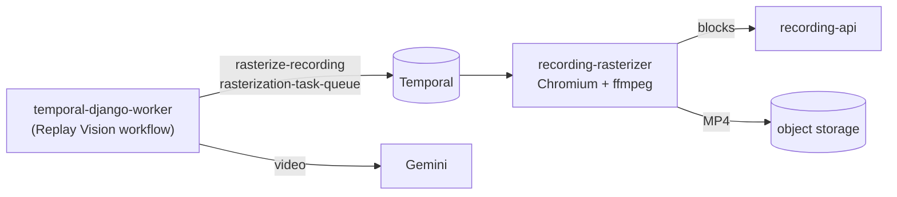

# Recording rasterizer (Replay Vision, video exports)

Replay Vision scans and replay video exports turn a recording into a video first. PostHog sends
that step (`rasterize-recording`) to its own Temporal queue, `rasterization-task-queue`, served by
a separate Node.js worker that plays the recording in `chrome-headless-shell` and writes an MP4 to
object storage. Upstream's hobby compose has no such worker, and `TEMPORAL_USE_SINGLE_TASK_QUEUE`
does not collapse that queue. Without the worker, scans sit at "Running" until the activity times
out (40 minutes) and nothing is charged or analysed.

The chart runs it as `<release>-recording-rasterizer` (`rasterizer.enabled`, default on), with
upstream's image `ghcr.io/posthog/posthog-recording-rasterizer` (built only when its code changes,
so `master` is pinned by digest at sync time).



## Chromium's sandbox needs a seccomp profile

Recordings are untrusted: anyone with a project's public token can send one. Chromium's sandbox
(user, PID and network namespaces plus its own seccomp filter for renderers) is what keeps a
renderer exploit away from the worker process, which holds `SECRET_KEY` and the object storage
keys. That sandbox calls `clone`/`unshare` with namespace flags and `chroot`, which the container
runtime's default profile (`RuntimeDefault`) blocks:

```text
FATAL:zygote_host_impl_linux.cc(130)] No usable sandbox!
```

`Unconfined` would work but opens the whole syscall surface and is rejected by the baseline and
restricted Pod Security Standards. Use a Localhost profile instead:

1. [`seccomp/chrome-sandbox.json`](seccomp/chrome-sandbox.json) is moby's default profile
   (v28.3.3) plus one rule that allows `clone`, `unshare` and `chroot`. Put it on every node that
   may run the rasterizer, under the kubelet's seccomp directory:
   `<kubelet root-dir>/seccomp/profiles/chrome-sandbox.json` (`/var/lib/kubelet/seccomp/...`;
   k0s: `/var/lib/k0s/kubelet/seccomp/...`). A DaemonSet that copies it from a ConfigMap does
   this well; an example is below.
2. Point the rasterizer at it:

   ```yaml
   rasterizer:
     seccompProfile: {type: Localhost, localhostProfile: profiles/chrome-sandbox.json}
   ```

The nodes also need unprivileged user namespaces: `sysctl kernel.unprivileged_userns_clone` = 1
(Debian, most kernels). Ubuntu 23.10+ blocks them through AppArmor
(`kernel.apparmor_restrict_unprivileged_userns=1`); keep the rasterizer off such nodes with
`rasterizer.nodeSelector`.

If your cluster cannot load Localhost profiles, `rasterizer.chromeSandbox: false` starts Chromium
with `--no-sandbox`. Then the egress policy and the pod's own restrictions (non-root, no
capabilities, read-only root, no service account token) are the only barriers. Read the
`values.yaml` comment first.

<details>
<summary>Example: install the profile with a DaemonSet</summary>

```yaml
apiVersion: apps/v1
kind: DaemonSet
metadata: {name: seccomp-profile-installer, namespace: kube-system}
spec:
  selector: {matchLabels: {app: seccomp-profile-installer}}
  template:
    metadata: {labels: {app: seccomp-profile-installer}}
    spec:
      tolerations: [{operator: Exists}]
      initContainers:
        - name: install
          image: busybox:1.37.0
          command: [sh, -ec, "mkdir -p /host/profiles && cp /profiles/*.json /host/profiles/"]
          volumeMounts:
            - {name: profiles, mountPath: /profiles, readOnly: true}
            - {name: host, mountPath: /host}
      containers:
        - {name: pause, image: registry.k8s.io/pause:3.10}
      volumes:
        - name: profiles
          configMap: {name: seccomp-profiles}   # kubectl create configmap seccomp-profiles --from-file=chrome-sandbox.json
        - name: host
          hostPath: {path: /var/lib/kubelet/seccomp, type: DirectoryOrCreate}
```

</details>

## Egress

Upstream routes Chromium and the S3 client through an egress proxy (smokescreen) and refuses to
start in production without one. `rasterizer.egressProxy` sets it. Left empty, the chart sets
`RASTERIZER_USE_PROXY=false` and, with `networkPolicy.enabled`, adds an egress policy: DNS,
Temporal (7233), recording-api (6738), the bundled SeaweedFS when used, and public addresses on
80/443 (recorded pages' stylesheets and images, S3). Private, CGNAT, link-local and loopback
ranges are blocked (`rasterizer.networkPolicy.blockedCidrs`); add an in-cluster S3 with
`rasterizer.networkPolicy.extraEgress`.

## Sizing

Each render holds a Chromium (300–800 MB). Defaults: `maxConcurrentActivities: 2`, requests
768Mi, limit 3Gi; above 70 % of the limit the worker takes only one render at a time.
The first sweep after enabling a scanner can queue a hundred scans; they drain at that rate.

## Checking it

```bash
kubectl -n posthog logs deploy/posthog-recording-rasterizer | grep -E 'activity complete|error'
temporal workflow count --query 'WorkflowType="replay-vision-apply-scanner" AND ExecutionStatus="Completed"'
```
